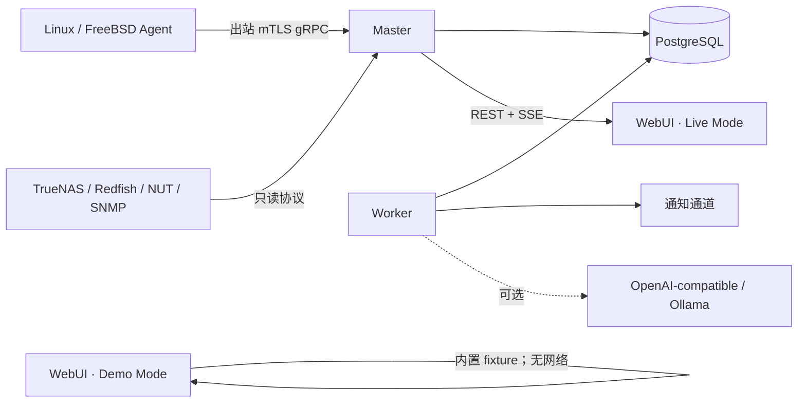

# 架构

## 目标与边界

Monitored 的设备遥测主链路不依赖 LLM、Redis 或通知服务。PostgreSQL 是事实来源；Redis 预留给队列、锁、限流和短期状态，Redis 故障不能阻断基本采集入库。首版不包含多租户、多 Master、Kubernetes、完整日志检索、APM 或分布式追踪。

## 服务职责

- `server`：认证/RBAC、REST/SSE、Agent gRPC、入库、连接与审批 API。
- `worker`：幂等聚合、保留、确定性规则计算、通知持久队列。
- `agent`：能力探测、本机只读采集、WAL、Master 下发任务。
- `web`：React/TypeScript + Next.js standalone Node 镜像，提供明确的 Demo/Live 模式、设备专页、审批与管理视图；不包含云托管运行时。
- `postgres`：资产、序列、历史、工作流和追加式审计。
- `redis`：可选；当前核心写路径不依赖它。

## 数据模型

`Asset` 通过 `parent_id` 组成主机→总线/机箱→设备拓扑。`SensorDefinition.stable_id` 保存稳定身份、原始来源/路径/名称、UCUM 单位、缩放、计数器语义、阈值、采样周期、质量和发现状态。原始样本引用 `metric_series`，并保留 source、quality 和 collection error。

发现状态为 `new → present → stale → removed`。快照中观察到的传感器恢复为 present；连续 3 次缺失进入 stale，6 次进入 removed。状态改变不会删除历史。

## Agent 流

第一个 gRPC envelope 必须是 Registration，`agent_id` 必须与客户端证书 CN、DNS SAN 或 URI SAN 末段一致。随后传输能力清单、资产快照、样本、心跳、WAL 缺口和任务结果。Master 反向下发 discovery、只读 diagnostic、已审批 action 和受本地策略约束的 Agent update；每个消息有 message ID 与 ACK。

正式契约位于 `proto/monitored/v1/agent.proto`，生成代码提交在 `gen/`，便于离线构建。

## 写入与聚合

入库单批上限：500 assets、5,000 sensors、20,000 samples。原始样本按 recorded time 分区；Worker 使用幂等 upsert 生成 1m 与 1h 的 min/avg/max/count/first/last。默认保留为原始 7 天、1m 90 天、1h 2 年。

## 确定性与智能边界

告警只由 `internal/rules` 状态机决定。LLM 只能生成待审核标注或结构化诊断，不改变原始身份、数值换算、阈值或规则，也不能触发动作。动作必须创建不可变规范载荷、由 Admin 审批，并经一次性短期令牌发送给目标 Agent。
